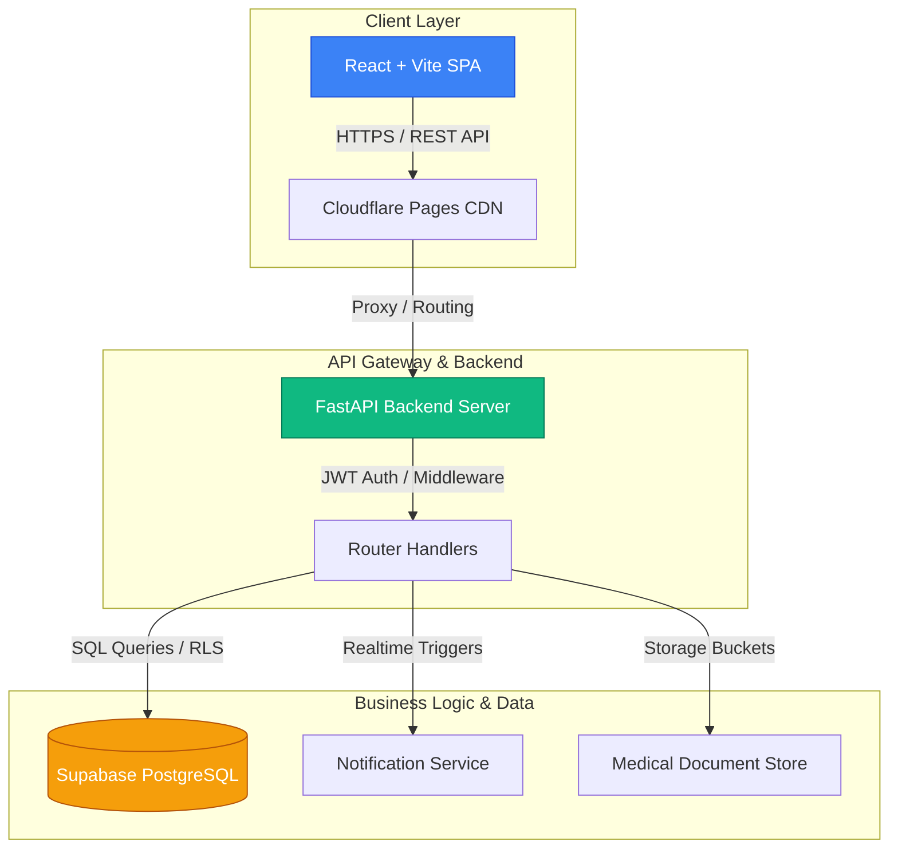

<div align="center">

# 🏥 SaarthiCare
### *Intelligent Healthcare Referral & Closed-Loop Patient Navigation SaaS Platform*

[]()
[]()
[]()
[]()
[]()
[]()

[Live Demo](https://saarthiicare-frontend.onrender.com) • [Deployment Guide](./DEPLOYMENT.md) • [Project Structure](./PROJECT_STRUCTURE.md)

</div>

---

## 📋 Table of Contents
1. [The Problem](#-the-problem)
2. [Our Solution](#-our-solution)
3. [Key Features](#-key-features)
4. [Why SaarthiCare is Different](#-why-saarthicare-is-different)
5. [System Architecture](#-system-architecture)
6. [Technology Stack](#-technology-stack)
7. [How It Works (User Journey)](#-how-it-works-user-journey)
8. [Project Structure](#-project-structure)
9. [Installation & Local Setup](#-installation--local-setup)
10. [Environment Variables](#-environment-variables)
11. [Real-World Impact](#-real-world-impact)
12. [Security & Reliability](#-security--reliability)
13. [Future Roadmap](#-future-roadmap)
14. [Contribution Guidelines](#-contribution-guidelines)
15. [Team & Acknowledgements](#-team--acknowledgements)

---

## 🚨 The Problem

In public health systems, grassroots primary health centers (PHCs) frequently refer critical or specialized patients to tertiary care hospitals. However, this referral pipeline suffers from severe systemic failures:
- **Zero Visibility**: PHC doctors have no tracking mechanism after a patient leaves the clinic.
- **Lost in Transition**: Up to 40% of referred patients never make it to the specialist hospital due to lack of coordination or appointment friction.
- **Fragmented Records**: Paper-based or unlinked digital records lead to repeated diagnostics, delays in critical care, and poor clinical outcomes.
- **Lack of Accountability**: No closed-loop verification confirming whether a consultation occurred or if follow-up care was delivered.

---

## 💡 Our Solution

**SaarthiCare** is an end-to-end healthcare referral and patient navigation SaaS platform designed to bridge the gap between primary healthcare centers (PHCs) and tertiary specialist hospitals. 

It establishes a **backend-authoritative closed-loop referral workflow** that tracks patients from initial triage at a PHC all the way to specialist consultation, appointment scheduling, treatment completion, and post-discharge follow-up.

---

## ✨ Key Features

| Feature | Description | Value Provided |
| :--- | :--- | :--- |
| **Multi-Role Dashboards** | Tailored workspaces for PHC Operators, Specialist Doctors/Hospitals, and Health Supervisors. | Streamlined workflows adapted to each medical stakeholder's operational needs. |
| **End-to-End Referral Lifecycle** | Tracks referrals across 7 distinct states: *Created → Submitted → Accepted → Appointment → Consultation → Follow-up → Closed*. | Eliminates drop-offs and guarantees complete oversight of patient navigation. |
| **Appointment Scheduling System** | Integrated calendar and scheduling module for booking specialist slots with conflict validation. | Reduces wait times and ensures structured patient arrivals at tertiary facilities. |
| **Backend-Authoritative Closure** | Secure referral completion panel restricted by role-based permissions and strict RLS policies. | Ensures data integrity and prevents unauthorized status alterations. |
| **Notification Center** | Real-time alert feed tracking referral status updates, appointment reminders, and urgent actions. | Keeps all stakeholders instantly informed of critical patient care milestones. |
| **Dual Authentication** | Supports both Supabase Auth (JWT) and legacy HMAC/HS256 tokens for flexible deployment. | Seamless access across cloud-native and offline-first environments. |

---

## ⚖️ Why SaarthiCare is Different

1. **True Closed-Loop Tracking**: Unlike traditional hospital management systems (HMS) that stop at hospital gates, SaarthiCare bridges the journey *between* rural PHCs and urban hospitals.
2. **Strict RLS & Data Sovereignty**: Leverages PostgreSQL Row Level Security (RLS) ensuring PHCs only see their referred patients while specialists manage their incoming queues.
3. **Optimized for Low-Bandwidth Environments**: Lightweight Vite frontend with cached state management ensures responsiveness even on rural cellular networks.
4. **Zero Vendor Lock-In**: Built on an open stack (FastAPI, React, PostgreSQL/Supabase) deployable on standard cloud infrastructure (Render + Cloudflare Pages).

---

## 📊 System Architecture



---

## 🛠️ Technology Stack

- **Frontend**: React 18, Vite, Tailwind CSS, Lucide Icons, React Router.
- **Backend**: FastAPI, Python 3.11+, Pydantic v2, Uvicorn, Python-Jose (JWT).
- **Database & Auth**: Supabase PostgreSQL, Row Level Security (RLS), Supabase Auth.
- **Testing**: Pytest, FastAPI TestClient.
- **Deployment & Hosting**: Render (Frontend + Backend), Cloudflare Pages (CDN & SPA Routing).

---

## 🚶 How It Works (User Journey)

1. **Patient Registration & Triage (PHC)**:
   - A PHC medical officer evaluates a patient requiring specialist intervention.
   - The officer creates a digital referral specifying symptoms, urgency, and specialty required.
2. **Review & Triage (Specialist Hospital)**:
   - The specialist hospital dashboard receives the incoming referral in real-time.
   - The specialist reviews clinical notes and accepts or requests more information.
3. **Appointment Booking**:
   - Upon acceptance, an appointment slot is scheduled via the integrated calendar system.
   - The PHC and patient receive immediate notification.
4. **Consultation & Closure**:
   - The patient visits the specialist hospital; diagnosis and prescriptions are recorded.
   - The specialist submits closure notes, transitioning the referral to **Closed / Follow-up**.

---

## 📁 Project Structure

```
SaarthiCare/
├── backend/
│   ├── app/
│   │   ├── api/            # FastAPI routers (auth, referrals, appointments, etc.)
│   │   ├── core/           # Security, config, and Supabase client setup
│   │   ├── database/       # Connection pooling, schema, and seed data
│   │   └── schemas/        # Pydantic validation models
│   ├── tests/              # Pytest test suite
│   └── requirements.txt    # Python dependencies
├── frontend/
│   ├── public/             # Static assets & SPA routing (_redirects)
│   ├── src/
│   │   ├── components/     # Reusable UI components & NotificationCenter
│   │   ├── pages/          # Role dashboards & Referral workflows
│   │   ├── services/       # API client integration
│   │   └── utils/          # Calendar and referral status helpers
│   ├── package.json        # Node.js dependencies
│   └── vite.config.js      # Vite build configuration
├── supabase/
│   └── migrations/         # SQL schema migrations (0001 to 0007)
├── DEPLOYMENT.md           # Production hosting documentation
├── PROJECT_STRUCTURE.md    # Detailed directory reference
└── render.yaml             # Render deployment blueprint
```

---

## 🚀 Installation & Local Setup

### Prerequisites
- Node.js (v18+)
- Python (v3.11+)
- Git

### 1. Clone the Repository
```bash
git clone https://github.com/HarshBuild/SaarthiiCare.git
cd SaarthiCare
```

### 2. Backend Setup
```bash
cd backend
python -m venv .venv
# On Windows:
.\.venv\Scripts\activate
# On macOS/Linux:
# source .venv/bin/activate

pip install -r requirements.txt
```

Run the backend server:
```bash
uvicorn app.main:app --reload --port 8000
```

### 3. Frontend Setup
Open a new terminal window:
```bash
cd frontend
npm install
npm run dev
```

The frontend will be accessible at `http://localhost:5173` communicating with the backend at `http://localhost:8000/api`.

---

## 🔐 Environment Variables

Create `.env` files based on `.env.example` in both directories.

### Backend (`backend/.env`)
```env
APP_ENV=development
CORS_ORIGINS=*
SECRET_KEY=your-secure-super-secret-key
SUPABASE_URL=your-supabase-url
SUPABASE_SERVICE_ROLE_KEY=your-service-role-key
```

### Frontend (`frontend/.env`)
```env
VITE_API_BASE_URL=http://localhost:8000/api
VITE_SUPABASE_URL=your-supabase-url
VITE_SUPABASE_ANON_KEY=your-anon-key
```

---

## 🌍 Real-World Impact

- **Reduced Referral Drop-Off**: Guaranteed tracking minimizes the risk of patients getting lost between primary and tertiary facilities.
- **Optimized Hospital Resource Allocation**: Advanced scheduling prevents emergency department overcrowding and structures specialist queues.
- **Empowered Rural Healthcare Workers**: Provides PHC staff with digital tools previously exclusive to high-end private healthcare systems.

---

## 🛡️ Security & Reliability

- **Token Validation**: Secure JWT verification on every protected backend route.
- **Row Level Security (RLS)**: Enforced at the database layer in PostgreSQL to prevent cross-tenant data leaks.
- **CORS & Rate Limiting**: Strict origin policies and input validation via Pydantic schemas.
- **Comprehensive Testing**: Full test coverage verifying appointments, auth flows, and schema migrations.

---

## 🗺️ Future Roadmap

- [ ] **Phase 1**: Offline-first progressive web app (PWA) sync for remote PHCs with intermittent connectivity.
- [ ] **Phase 2**: AI-powered triage recommendations for primary health workers based on symptoms.
- [ ] **Phase 3**: Multilingual regional language support for rural grassroots workers.
- [ ] **Phase 4**: Automated SMS/WhatsApp patient appointment reminders via Twilio integration.

---

## 👥 Contribution Guidelines

Contributions are welcome! Please follow these steps:
1. Fork the repository.
2. Create your feature branch (`git checkout -b feature/AmazingFeature`).
3. Commit your changes (`git commit -m 'feat: Add amazing feature'`).
4. Push to the branch (`git push origin feature/AmazingFeature`).
5. Open a Pull Request.

---

## 📜 License

Distributed under the MIT License. See `LICENSE` for more information.

---

<div align="center">

*Empowering healthcare access through intelligent technology.*  
[Back to Top](#-saarthicare)

</div>
